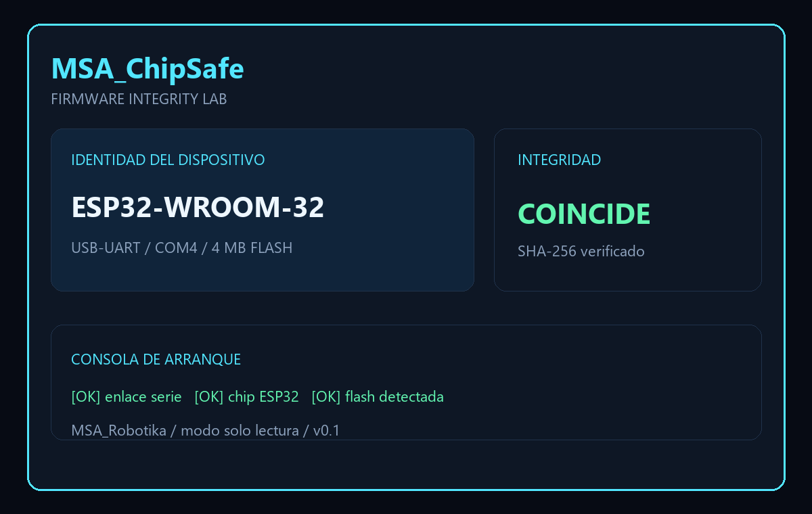

# MSA-ChipSafe

> **Ficha del proyecto · MS ROBOTIKA**  
> **Estado:** Prototipo inicial de auditoría de integridad ESP32 · **Licencia:** [LICENSE](LICENSE)  
> [Estado técnico y evidencias](docs/PROJECT_STATUS.md) · [Abrir una incidencia](https://github.com/msrobotika/MSA-ChipSafe/issues/new/choose)  
> **Límite:** Funciones de backup y restauración requieren comprobación física por modelo. La pantalla de muestra no acredita firmware validado.

Laboratorio portátil de integridad para placas ESP32. La pantalla muestra quién es la placa, qué memoria tiene y si su firmware coincide con una copia de confianza.

## Primera versión

- Identificación del chip, MAC, flash y modo de arranque.
- Copia de seguridad de solo lectura con SHA-256.
- Comparación contra una imagen conocida.
- Registro de consola y evidencias en microSD.
- Interfaz de pantalla: **Identidad**, **Flash**, **Integridad**, **Consola** y **Evidencias**.
- Restauración protegida con confirmación explícita y comprobación posterior.

Esta versión se desarrolla **sin carcasa**. La placa se puede usar sobre una mesa o en protoboard; el diseño mecánico se añadirá más adelante como módulo independiente.

## Seguridad y límites

ChipSafe está pensado para placas propias o autorizadas. No intenta atacar redes ni extraer secretos de terceros. Las operaciones destructivas están separadas de la auditoría y requieren confirmación doble.

La placa ESP32 clásica puede actuar como pantalla/controlador por UART. Para una herramienta autónoma que lea USB directamente hará falta una ESP32-S3 con USB-OTG o un adaptador USB-host; el modo PC + USB-UART se mantiene como alternativa compatible.

## Estructura

```text
firmware/       Interfaz y protocolo para la pantalla
host/            Utilidades de auditoría para Windows/Linux
docs/            Protocolo, montaje y modelo de amenazas
```

## Estado

Prototipo inicial. La próxima entrega implementará el protocolo de estado y la vista **Identidad** antes de añadir restauración.

## Licencia

MIT. Consulta `LICENSE`.


## Captura de interfaz



La imagen muestra la vista de identidad, integridad y consola de auditoría.
